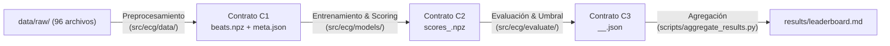

# Metodología de Trabajo y Estructura del Proyecto

Este documento consolida la arquitectura del repositorio, los contratos de datos, las reglas metodológicas para evitar sesgos en el análisis biomédico y el flujo de colaboración para el equipo.

---

## 1. El Problema y Enfoque del Proyecto

* **Objetivo**: Detección de arritmias cardíacas en registros de electrocardiograma (ECG) mediante un **Autoencoder Convolucional 1D (Conv1D)** desarrollado en **PyTorch**.
* **Base de datos**: **MIT-BIH Arrhythmia Database** (48 registros de 30 minutos de duración, muestreados a 360 Hz con dos derivaciones y anotaciones validadas por cardiólogos).
* **Paradigma no supervisado**:
  * Las arritmias son eventos infrecuentes con un desbalance severo de clases.
  * El modelo se entrena **únicamente con latidos sinusales normales** (símbolo `'N'`).
  * **Hipótesis**: La red aprende a reconstruir fielmente la morfología del latido normal. Ante un latido anómalo (arritmia), el error de reconstrucción (MSE) será significativamente más alto.
* **Criterio de clasificación**:
  * Un latido se clasifica como anómalo si su MSE supera un umbral determinado a priori como el **percentil 95** del error en los latidos normales del conjunto de validación (`DS1_VAL`).

---

## 2. Blindaje Metodológico: Las 12 Reglas Duras (AGENTS.md)

Para garantizar la reproducibilidad y la validez científica del proyecto frente a los errores metodológicos más frecuentes en la literatura de ECG, se establecieron 12 reglas estrictas:

1. **`data/raw/` es de solo lectura**: Los datos crudos nunca se modifican, renombran ni mueven. Su integridad se valida mediante sumas de verificación SHA-256 (`data/MANIFEST.sha256`).
2. **Cero datos ni pesos en git**: Ningún archivo `.npz`, `.pt`, `.csv` crudo, ejecuciones (`runs/`) ni entornos virtuales (`.venv/`) se suben al repositorio. La única excepción permitida son los modelos finales congelados en `models/frozen/*.pt`.
3. **Cero rutas absolutas**: Toda ruta se construye de forma canónica y relativa a través de `src/ecg/paths.py` (con soporte para la variable de entorno `ECG_RAW_DIR`).
4. **Split "test" (DS2) estrictamente prohibido durante desarrollo**: No se usa para ajustar hiperparámetros ni para calcular umbrales. Su acceso está bloqueado por software (`PermissionError`). Solo se evalúa una única vez al final del proyecto por la persona designada como **Guardián del Test** con la bandera `--final`.
5. **Partición por paciente (inter-paciente)**: Definida exclusivamente en `src/ecg/config.py`. Queda terminantemente prohibido hacer splits aleatorios por latido individual (lo cual generaría fuga masiva de morfología paciente-específica).
6. **Inmutabilidad de contratos**: Los esquemas de datos definidos en `docs/contracts.md` son inmutables. Modificarlos exige un PR explícito con la etiqueta `contract-change`.
7. **Aislamiento de tareas**: Cada desarrollador y agente trabaja exclusivamente en los módulos correspondientes a su tarea asignada.
8. **Hiperparámetros fuera del código**: Todos los parámetros de entrenamiento residen en archivos YAML bajo `configs/`.
9. **Aleatoriedad determinista**: Toda generación o split aleatorio utiliza la función centralizada `seed_everything()` de `src/ecg/utils/seed.py`.
10. **Comprobación obligatoria**: Todo PR debe pasar localmente y en CI `pytest -q` y `ruff check .` en verde.
11. **Honestidad métrica**: Si una forma, conteo o métrica no coincide con lo esperado, jamás se maquilla o fuerza el código: se detiene el trabajo y se documenta la discrepancia.
12. **Flujo de commits**: Sin push directo a `main`. Commits locales atómicos, escritos en español e imperativo (ej. *"Implementar normalización z-score por latido"*).

---

## 3. Partición de Datos (Inter-Paciente)

Siguiendo el estándar canónico de **de Chazal et al. (2004)** y la norma **AAMI EC57**:

* **Registros Excluidos (4 registros)**: `[102, 104, 107, 217]`
  * Pacientes con marcapasos artificiales cuyas espigas y morfología alterada no corresponden a la conducción intrínseca.
* **Conjunto de Desarrollo DS1 (22 registros)**:
  * **Entrenamiento (`DS1_TRAIN`, 18 registros)**: `[101, 106, 108, 109, 112, 114, 115, 118, 122, 124, 201, 203, 205, 207, 208, 215, 220, 230]`
    * Se filtran exclusivamente los latidos con símbolo `'N'`.
  * **Validación interna (`DS1_VAL`, 4 registros)**: `[116, 119, 209, 223]`
    * Contiene latidos normales y anómalos. Se utiliza para elegir el umbral (percentil 95 en normales) y monitorear el entrenamiento.
* **Conjunto de Prueba Final DS2 (`DS2_TEST`, 22 registros)**:
  * `[100, 103, 105, 111, 113, 117, 121, 123, 200, 202, 210, 212, 213, 214, 219, 221, 222, 228, 231, 232, 233, 234]`
  * Reservado para la evaluación ciega final.
* *Nota*: Los registros 201 (train) y 202 (test) provienen del mismo paciente. Se mantiene la partición de de Chazal tal cual para comparar con la literatura; es una limitación documentada en D-013.

---

## 4. Contratos de Interfaz (docs/contracts.md)

El flujo del proyecto está desacoplado mediante 3 contratos formales:



### Contrato C1: Latidos Extraídos (`data/processed/beats.npz`)
* `X`: `float32`, forma `(n, 256)`. Derivación MLII filtrada (0.5–40 Hz), en mV, **sin normalizar**.
  * Ventana de 256 muestras centrada asimétricamente en el pico R: `[r - 90, r + 166)` a 360 Hz (~711 ms, cubre de la onda P a la T).
* `symbol`: `<U1`, anotación original del latido (`'N'`, `'V'`, `'A'`, etc.).
* `aami`: `<U1`, clase AAMI estándar en `{'N', 'S', 'V', 'F', 'Q'}`.
* `label`: `int8`, `0` si `symbol == 'N'`, de lo contrario `1`.
* `record`: `int16`, número de paciente.
* `split`: `<U5`, `'train'`, `'val'` o `'test'`.
* `r_sample`: `int32`, índice temporal del pico R en la grabación continua.
* `rr_prev`, `rr_next`: `float32`, intervalos entre picos R en segundos (`NaN` en extremos).
* `mlii_noisy`: `bool`, indicador de artefactos severos de ruido en la derivación MLII.
* `meta.json`: Metadatos de procedencia (`fs=360`, versión de datos, conteos `split x aami`, commit de git).

### Contrato C2: Puntuaciones del Modelo (`runs/<run_id>/scores_<split>.npz`)
* `idx`: `int64`, índice de fila correspondiente en `beats.npz`.
* `error`: `float32`, MSE por latido (calculado sobre el latido estandarizado por z-score).
* Metadatos del latido propagados: `label`, `symbol`, `aami`, `record`, `mlii_noisy`.

### Contrato C3: Evaluación y Métricas (`results/<run_id>__<split>.json`)
* `run_id`, `split`, `threshold` (método, percentil, valor numérico calculado en validación).
* `confusion`: `tp`, `fp`, `fn`, `tn`.
* `global`: AUC-ROC, AUC-PR, Sensibilidad (Recall), Especificidad, Precisión, F1 y Accuracy.
* `per_symbol_sensitivity` y `per_aami_sensitivity`: Desglose del recall para clases `S`, `V`, `F`, `Q`.
* `aami_view`: Métricas recalculadas considerando `L`, `R`, `e`, `j` como normales (para contraste con la literatura clínica).
* `clean_only`: Métricas recalculadas excluyendo latidos con `mlii_noisy == True`.

---

## 5. Estructura Implementada en el Repositorio

```text
ecg-autoencoder/
├── AGENTS.md                          # Reglas duras y convenciones para agentes y humanos
├── README.md                          # Guía de instalación rápida y roles del equipo
├── pyproject.toml                     # Paquete ecg (src/), configuración ruff y pytest
├── requirements.txt                   # Dependencias fijadas (versiones ==) compatibles multiplataforma
├── .gitignore                         # Exclusión de datos crudos/procesados, runs y modelos
├── .github/
│   ├── CODEOWNERS                     # Asignación de módulos a responsables de área
│   ├── pull_request_template.md       # Plantilla de PR con checklist estricto
│   └── workflows/
│       └── ci.yml                     # Pipeline CI (Python 3.11, CPU Torch, ruff, pytest)
├── configs/
│   ├── data.yaml                      # Configuración de muestreo, ventana, filtros y splits
│   └── train/                         # Hiperparámetros de entrenamiento (.gitkeep)
├── data/
│   ├── raw/
│   │   └── mitbih_database/           # 96 archivos originales (.csv y annotations.txt)
│   ├── processed/                     # Salida C1 (beats_mock.npz, meta_mock.json)
│   ├── MANIFEST.sha256                # Checksums SHA-256 de los 96 archivos crudos
│   └── README.md                      # Documentación del origen y verificación de datos
├── docs/
│   ├── contracts.md                   # Definición técnica formal de contratos C1, C2 y C3
│   ├── decisions.md                   # Registro de decisiones de arquitectura (ADR D-001 a D-012)
│   └── metodologia_y_estructura.md   # Este resumen metodológico
├── models/
│   └── frozen/                        # Checkpoints congelados para evaluación final
├── notebooks/                         # Notebooks de análisis por persona (ignorado en git)
├── results/
│   └── leaderboard.md                 # Tabla comparativa de experimentos
├── runs/
│   └── mock/                          # Salida de scores sintéticos C2
├── scripts/
│   ├── make_manifest.py               # Generador de data/MANIFEST.sha256
│   ├── verify_raw_data.py             # Verificador de integridad de datos crudos
│   ├── make_mock_beats.py             # Generador de latidos sintéticos C1 (P/QRS/T gaussianos)
│   ├── make_mock_scores.py            # Generador de errores sintéticos C2 (distribución lognormal)
│   └── aggregate_results.py           # Compilador de JSONs en results/leaderboard.md
├── src/
│   └── ecg/
│       ├── __init__.py                # Paquete ecg versión 0.1.0
│       ├── config.py                  # Constantes, listas de splits con aserciones al importar
│       ├── paths.py                   # Resolución canónica de rutas relativas a REPO_ROOT
│       ├── io.py                      # load_beats (con guardia de test) y validate_beats (C1)
│       ├── utils/
│       │   └── seed.py                # seed_everything(seed=42) para Python, NumPy y PyTorch
│       ├── data/                      # (Por implementar) Ingesta, filtrado y segmentación
│       ├── models/                    # (Por implementar) Arquitectura Conv1D y bucle de entrenamiento
│       └── evaluate/                  # (Por implementar) Métricas, umbral y final_test.py
└── tests/
    ├── test_config.py                 # Valida coherencia de splits y mapeos AAMI
    ├── test_contracts.py              # Valida C1 y C2 sobre datos sintéticos generados en tmp_path
    └── test_io_guard.py               # Valida que load_beats bloquee el split test sin permiso
```

---

## 6. Roles y Responsabilidades

| Rol | Marcador CODEOWNERS | Componentes a Cargo | Responsabilidad |
| :--- | :--- | :--- | :--- |
| **Integrador** | `@INTEGRADOR` | `src/ecg/config.py`<br>`requirements.txt`<br>`AGENTS.md`<br>`docs/contracts.md` | Configuración, dependencias, CI, gobierno de contratos y revisión de PRs estructurales. |
| **Datos** | `@DATOS` | `src/ecg/data/`<br>`docs/contracts.md` | Parseo de CSV/anotaciones, filtrado pasabanda 0.5–40 Hz, segmentación en ventana 256 y generación de `beats.npz` (C1). |
| **Modelo** | `@MODELO` | `src/ecg/models/`<br>`src/ecg/train.py`<br>`src/ecg/score.py`<br>`configs/train/`<br>`docs/contracts.md` | Diseño de Autoencoder Conv1D (cuello de botella de dimensión 32), entrenamiento en PyTorch sobre `DS1_TRAIN` (solo 'N') y cálculo de MSE (C2). |
| **Evaluación** | `@EVALUACION` | `src/ecg/evaluate/`<br>`docs/contracts.md` | Cálculo de umbral percentil 95 en `DS1_VAL`, reporte de métricas C3, matriz de confusión y actualización del leaderboard. |
| **Guardián del Test** | Designado | `src/ecg/evaluate/final_test.py`<br>`models/frozen/` | Ejecución única al cierre del proyecto sobre `DS2_TEST` utilizando el modelo congelado. |

---

## 7. Flujo de Trabajo Práctico para los Integrantes

1. **Crear rama de trabajo**:
   ```bash
   git checkout -b feat/nombre-tarea
   ```
2. **Desarrollar y probar con mocks**:
   * Los desarrolladores de modelos o evaluación no necesitan esperar a que el pipeline de datos esté listo; pueden utilizar los mocks generados con `python scripts/make_mock_beats.py` que cumplen con el contrato C1.
3. **Verificar antes de abrir PR**:
   ```bash
   pytest -q        # Debe reportar 12 pruebas pasadas
   ruff check .     # Debe reportar 'All checks passed!'
   ```
4. **Abrir Pull Request**:
   * Llenar la plantilla obligatoria (`.github/pull_request_template.md`).
   * GitHub Actions ejecutará automáticamente las pruebas y los linters.
   * El responsable del área (según `CODEOWNERS`) revisará y aprobará el cambio.
